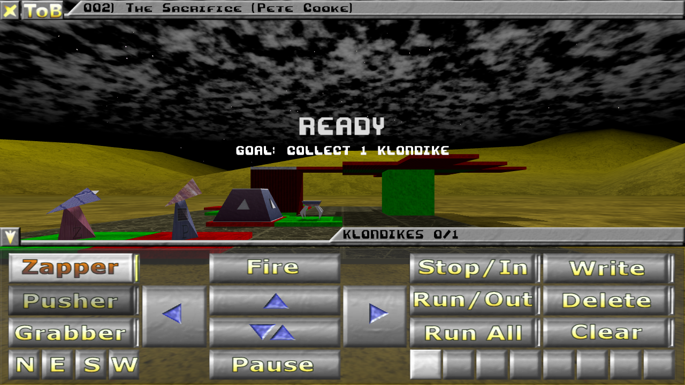
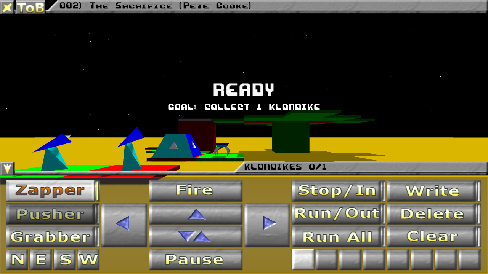
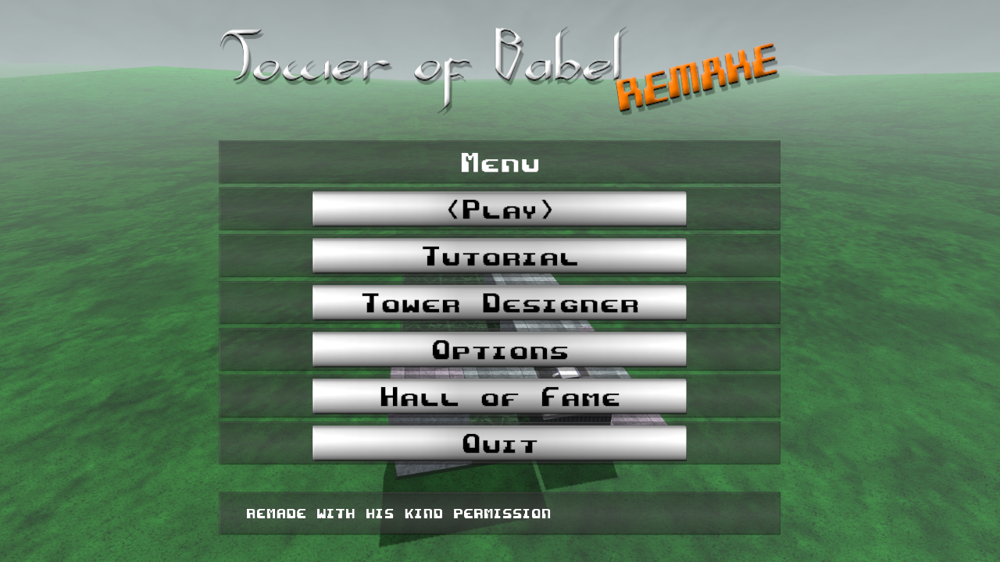
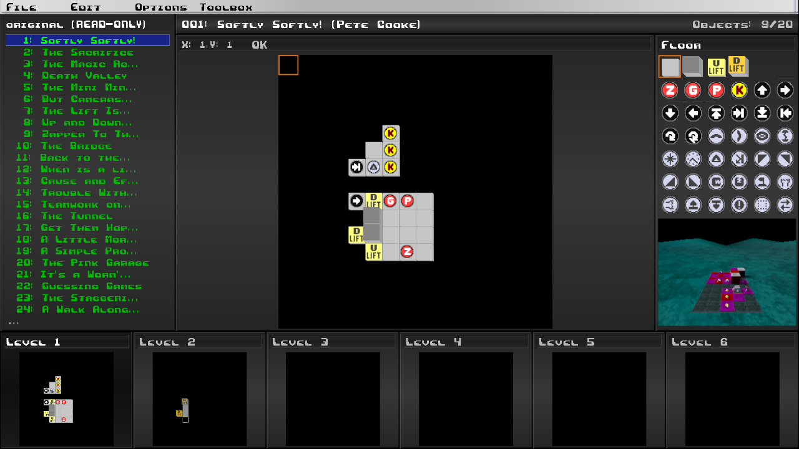

# ToB 2026

<!-- github-only -->
**Tower of Babel 2026 - a 3D remake of Pete Cooke's 1989 puzzle game**, free and non-commercial, for Windows and
Linux.

**[Download ToB 2026](https://github.com/mlatzig/ToB2026/releases/latest)** - unpack it and play; no Java needed.






<!-- /github-only -->

A free remake of *Tower of Babel*, the 3D puzzle game by Pete Cooke (Rainbird / MicroProse, 1989 for the Atari ST and
the Acorn Archimedes, 1990 for the Amiga). You command up to three robot spiders - a zapper, a pusher and a grabber -
in towers of floors, lifts and strange machines, steering them directly or with small programs, to collect the
klondikes or destroy the enemies before the time runs out.

ToB 2026 plays the 117 original towers and the 9 tutorial towers of the Amiga version in a 3D world, in a reworked
look or in the original's colours (the Classic look), shows its 18 demo towers in the interludes and the demo, and
has a Tower Designer for your own towers. It is the third remake by the same author, after ToB 2005 and ToB 2009,
and a hobby project offered to fans of the original.

## Origin and permission

Pete Cooke designed and programmed *Tower of Babel* from 1988 to 1990. In December 2004 he allowed Mario Latzig by
e-mail to make a free PC version of the game. He assumed that MicroProse might still hold rights to the original
game, while he had kept the copyright, and expected no objection to a version that is not sold. ToB 2026 therefore
is and stays free and non-commercial. It keeps the original's rules: where the remake plays differently from the
original, that is a bug.

ToB 2026 is not affiliated with or endorsed by MicroProse or any later holder of rights to *Tower of Babel*.
*Tower of Babel* is (c) Pete Cooke. If you hold rights to the original game or to any content here and object to
its publication, please open an issue at <https://github.com/mlatzig/ToB2026/issues>: the content concerned
will be removed.

## Playing

Download the package for your system, unpack it anywhere and start the game; Java and Maven are not needed:

| System | Package | Start |
|---|---|---|
| Windows 10 or 11, 64 bit | `ToB2026-1.0.0-windows.zip` | `ToB2026\ToB2026.exe` |
| Linux, x86-64 | `ToB2026-1.0.0-linux.zip` | `tob2026/bin/tob2026` |

The game needs a graphics card with OpenGL 3.2. It keeps your profiles, settings and own towers in
`%APPDATA%\ToB2026` on Windows and in `~/.local/share/tob2026` on Linux (`$XDG_DATA_HOME/tob2026` if that is set);
removing the unpacked folder leaves them there. Unpack the Linux package with a tool that keeps the file
permissions, such as `unzip`; `tob2026/install-desktop-entry.sh` then adds the game to your applications menu (run
it again after moving the folder; `--remove` takes the entry away). Without a sound device the game starts
silently; Options then says "No audio device found". The Windows launcher is not signed, so on its first start
Windows may warn that the publisher is unknown
("Windows protected your PC"): choose More info, then Run anyway. The very first start can take a while because
Windows checks the new files; if the loading screen seems to stop, click the game in the taskbar once.

## Controls

The panel (Tab) has buttons for the spiders, the cameras and the programs, and the mouse works everywhere. The
default keys:

| Key | Action |
|---|---|
| Up, Down, Left, Right | move forward, move back, turn left, turn right |
| Space | fire (zapper: shoot, pusher: push, grabber: grab) |
| F1, F2, F3 | select the zapper, the pusher, the grabber |
| F5, F6, F7, F8 | look through the north, east, south, west camera |
| Page Up, Page Down | zoom in, zoom out |
| Ctrl + Up, Down, Left, Right, Space | write a program step: move, turn, fire |
| 1 to 8 | choose program slot 1 to 8 |
| W, Backspace, C | write mode, delete a step, clear the program |
| R, S, Ctrl + R | run the program, stop, run all programs |
| Tab | show or hide the panel |
| P | pause |
| Esc, Enter | open and close the menu, choose in it |
| F9, F10 | restart the tower, give it up (after a question) |

Every key except Esc, Enter, F9 and F10 can be changed in Options, Keys.

## Reporting problems

Please open an issue at <https://github.com/mlatzig/ToB2026/issues> and attach the game's log file of the run that
went wrong: `%APPDATA%\ToB2026\logs\tob2026.log` on Windows, `~/.local/share/tob2026/logs/tob2026.log` on Linux.
The game writes a new one at every start and keeps the last five runs (`tob2026.1.log` is the run before, up to
`tob2026.4.log`). A game started with `-Dtob.userdir` writes them to that folder's `logs`.

## Building and running

You need a Java 21 JDK, Maven 3 and a graphics card with OpenGL 3.2. The game is developed and tested on Windows;
the libraries also bring their Linux and macOS parts.

```text
mvn compile exec:java -Dtob.userdir=<folder for profiles, settings and your own towers>
```

Without `-Dtob.userdir` the game keeps them in the same folder as the packages (see "Playing").
`mvn verify` builds the game and runs the tests (about a minute, no visible window). The tests that render
pictures offscreen need the graphics card; `-DexcludedGroups=offscreen` leaves them out.

`mvn -Prelease clean package` builds the player packages into `target/release/` (`clean`, because a jar or
libraries left by an earlier build must not end up in a package). It runs the tests first; `-DskipTests` leaves
them out, but `-Dmaven.test.skip=true` does not work: the build tool lives in the test classes. It needs Eclipse
Temurin in the version `tob.release.jdk` of `pom.xml` and builds the package of the system it runs on. On Windows
it then builds the Linux package inside WSL (distribution `Ubuntu`, another one with
`-Dtob.release.wslDistro=NAME`) with the same Temurin for Linux, installed once by `src/package/wsl-jdk.sh`;
without WSL or that JDK the build makes the Windows package only and says why (`-Dtob.release.linux=false` skips
it on purpose).

On GitHub every version tag `v*` starts the workflow `.github/workflows/release.yml`: it builds and tests both
packages on a Windows and a Linux runner (without the offscreen tests, as the runners have no graphics card, and
without the timing test) and attaches them to a draft release.

The pictures in `docs/images` are made offscreen by a tool in the test classes (one command line):

```text
mvn test-compile exec:java -Dexec.mainClass=de.latzig.game.tob.client.ReadmeScreenshots
    -Dexec.classpathScope=test -Dexec.args=docs/images -Dtob.userdir=target/readme-userdir
```

## Licences

| Part | Licence |
|---|---|
| Program code: everything under `src/` except `src/main/resources/assets`, plus `pom.xml` and the documents | GNU General Public License 3.0 or later (`LICENSE`) |
| Own assets: models, textures, the bitmap font, the GUI and effect atlases, the edited sounds and the music (`src/main/resources/assets` except `towers/`) | Creative Commons BY-NC-SA 4.0 (`LICENSE-ASSETS`) |
| The original towers (`src/main/resources/assets/towers`) | (c) Pete Cooke and the other tower authors; included with Pete Cooke's permission for non-commercial use; covered by neither licence above |
| Towers you build with the Tower Designer | yours |
| Third-party libraries | their own licences, listed in `CREDITS.md` |

## Credits

Original game: Pete Cooke. Original tower designs: Pete Cooke, Chris Newcombe, "Legin Drawnek", Tim Roberts and
Axeman Towers Ltd. Remake: Mario Latzig. Support and Analysis: Marcus Pantel. Thanks to Chris Newcombe for the
contact to Pete Cooke. The full credits, the music, the sounds, the font and the third-party software are in
[CREDITS.md](CREDITS.md).

## File formats

The tower libraries, meshes, the element catalogue, the GUI atlas and the font are described in
[docs/formats/README.md](docs/formats/README.md) in the repository <https://github.com/mlatzig/ToB2026>, for anyone
who wants to build towers or tools of their own.
